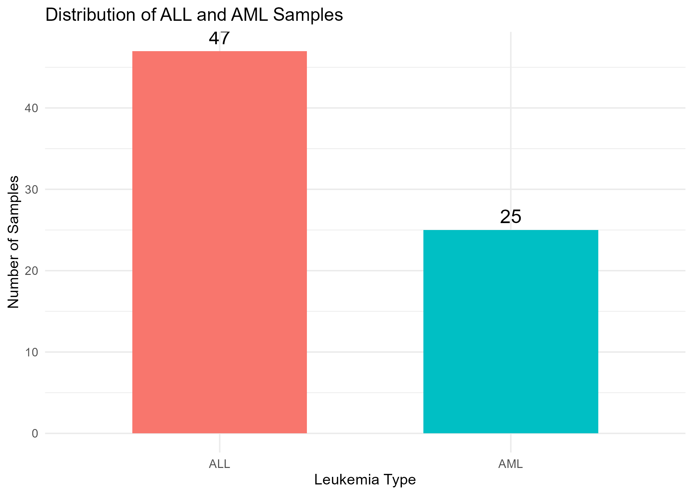
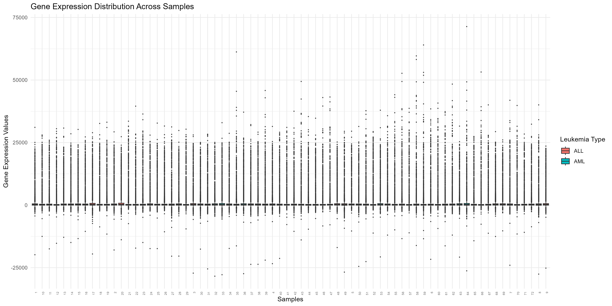
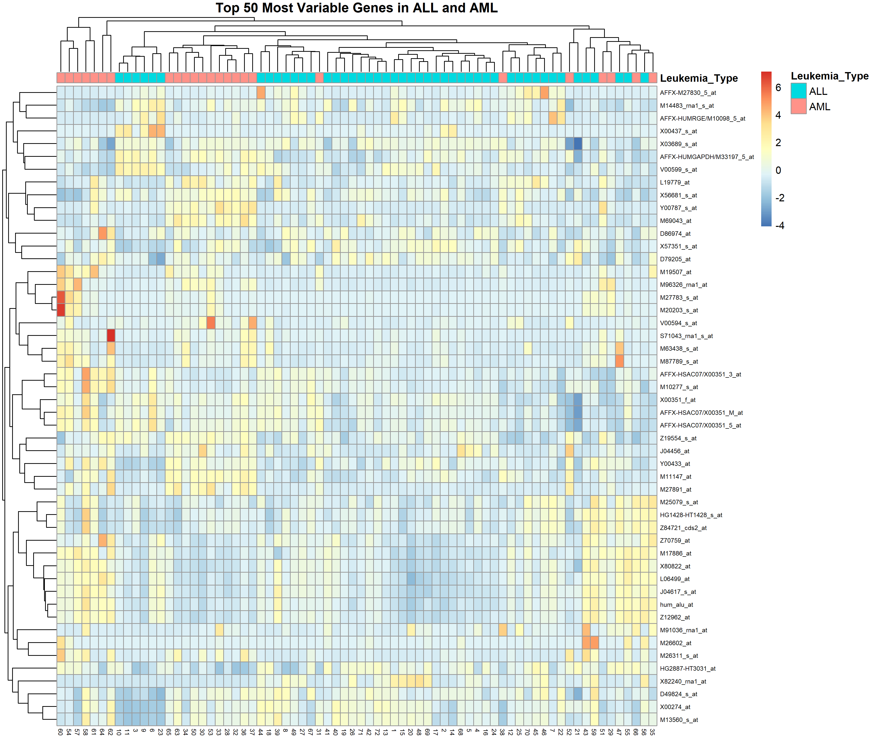
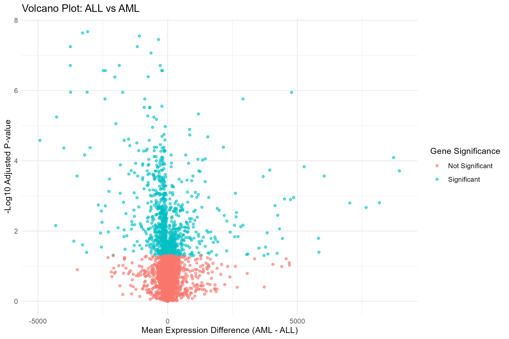

# Leukemia Classification Using Gene Expression Data: An Exploratory and Machine Learning Approach

## Abstract

Leukemia is a type of blood cancer that affects the production and development of blood cells. Acute Lymphoblastic Leukemia (ALL) and Acute Myeloid Leukemia (AML) are two major forms of acute leukemia. Identifying differences in their gene expression patterns can support research into leukemia classification.

This project analyses the Golub leukemia gene expression dataset using R. The dataset contains 7,129 genes across 72 patient samples, including 47 ALL and 25 AML samples. Exploratory data analysis, differential gene expression analysis and Support Vector Machine (SVM) classification were performed. A five-fold cross-validation approach was also used to evaluate classification performance.

The SVM model achieved 93.06% overall accuracy in five-fold cross-validation, demonstrating that gene expression patterns can help distinguish between ALL and AML samples in this dataset.

## 1. Introduction

Leukemia is a type of cancer that affects blood-forming tissues, particularly the bone marrow. It causes the abnormal production of white blood cells, which can interfere with the normal functioning of the immune system. Acute Lymphoblastic Leukemia (ALL) and Acute Myeloid Leukemia (AML) are two major types of acute leukemia. Although both affect blood cells, they differ in the types of cells involved and their biological characteristics.

Gene expression analysis is an important approach in bioinformatics because it helps researchers examine how genes behave under different biological conditions. Gene expression data can reveal patterns that distinguish different diseases or disease subtypes. Machine learning techniques can use these patterns to classify biological samples.

This project uses the Golub leukemia gene expression dataset to investigate whether gene expression patterns can distinguish between ALL and AML samples. The dataset contains expression measurements for 7,129 genes across 72 samples. Statistical analysis is used to identify genes with different expression levels between the two leukemia groups. A Support Vector Machine (SVM) model is then developed to classify samples based on selected gene expression features.

The main research question is:

**Can gene expression patterns be used to distinguish between Acute Lymphoblastic Leukemia (ALL) and Acute Myeloid Leukemia (AML) samples?**

The objectives of this project are:

- To explore and understand the Golub leukemia gene expression dataset.
- To examine the distribution and quality of the gene expression data.
- To identify genes that show significant expression differences between ALL and AML.
- To develop an SVM classification model using selected gene expression features.
- To evaluate model performance using a confusion matrix and five-fold cross-validation.

## 2. Dataset Description

### 2.1 Dataset Source

This project uses the Golub leukemia gene expression dataset, which is a publicly available biomedical dataset used in leukemia classification research. The dataset is accessed through the `golubEsets` Bioconductor package in R.

The dataset contains gene expression measurements from patient samples classified into two leukemia groups: Acute Lymphoblastic Leukemia (ALL) and Acute Myeloid Leukemia (AML).

### 2.2 Dataset Structure

The dataset contains the following characteristics:

| Characteristic | Description |
|---|---|
| Dataset name | Golub Leukemia Dataset |
| Number of genes | 7,129 |
| Number of samples | 72 |
| ALL samples | 47 |
| AML samples | 25 |
| Data type | Gene expression measurements |
| Data format | Numerical expression matrix |
| Classification target | ALL or AML |

Each row of the expression matrix represents a gene feature, while each column represents a patient sample. The corresponding sample information provides the leukemia classification labels and other available metadata.

### 2.3 Target Classes

The dataset contains two target classes:

- **Acute Lymphoblastic Leukemia (ALL):** This group contains 47 patient samples.
- **Acute Myeloid Leukemia (AML):** This group contains 25 patient samples.

The classification task focuses on distinguishing these two leukemia types using their gene expression patterns.

### 2.4 Data Characteristics

The expression matrix contains numerical values representing gene expression measurements. Some values are negative, which can occur in processed microarray expression data and should not automatically be treated as missing or invalid values.

The dataset also includes additional sample metadata, such as sample identifiers and biological characteristics. Some metadata fields contain missing values. However, the leukemia classification labels required for this project are available for all 72 samples.

The dataset is suitable for this exploratory classification project because it provides gene expression measurements together with known ALL and AML sample labels.

## 3. Data Preprocessing and Quality Control

Before performing statistical analysis and machine learning, the dataset was examined to understand its structure and quality.

### 3.1 Dataset Inspection

The dataset was loaded into R using the `golubEsets` Bioconductor package. The expression matrix and sample metadata were extracted separately.

The expression matrix contained 7,129 genes and 72 patient samples. Each sample was matched with its corresponding metadata to ensure that the correct leukemia classification label was assigned.

### 3.2 Missing Value Assessment

Missing values were checked in both the expression matrix and the sample metadata.

The expression matrix contained no missing values. However, several metadata variables, including FAB, Date, Gender, and other biological characteristics, contained missing observations.

Since the main analysis uses gene expression values and the ALL/AML classification labels, the missing values in unrelated metadata fields did not require removing patient samples.

### 3.3 Expression Value Inspection

The minimum and maximum expression values were examined to understand the numerical range of the dataset. The observed expression values ranged from -28,400 to 71,369.

Negative expression values were retained because they are part of the processed microarray data and do not necessarily represent errors or missing observations.

### 3.4 Data Preparation for Analysis

The sample metadata was arranged to match the order of the expression matrix columns. This ensured that every expression profile was associated with the correct ALL or AML label.

No unnecessary removal of genes or patient samples was performed at this stage. The prepared expression matrix was used for exploratory analysis, differential gene expression testing, and machine learning classification.

## 4. Exploratory Data Analysis (EDA)

Exploratory Data Analysis (EDA) was performed to understand the distribution of leukemia samples and the variation in gene expression measurements. Several visualisations were generated using the `ggplot2` and `pheatmap` packages in R.

### 4.1 Distribution of Leukemia Samples

The distribution of ALL and AML samples was examined using a bar chart.

The dataset contains 47 ALL samples and 25 AML samples. Therefore, ALL represents approximately 65.28% of the dataset, while AML represents approximately 34.72%.

This indicates that the dataset is moderately imbalanced, with more ALL samples than AML samples. This class distribution was considered when splitting the data and evaluating the classification model.



*Figure 1: Distribution of ALL and AML patient samples.*

### 4.2 Gene Expression Distribution

A boxplot was created to examine the distribution of gene expression values across individual patient samples. Each box represents the expression measurements for one sample and is coloured according to its leukemia type.

The visualisation shows variation in gene expression values among patient samples. This variation indicates that gene expression patterns are not identical across all samples. Such differences provide a basis for further statistical investigation and classification.



*Figure 2: Distribution of gene expression values across patient samples.*

### 4.3 Heatmap of the Top 50 Variable Genes

To explore variation across the dataset, the variance of each gene was calculated. The 50 genes with the highest expression variance were selected for visualisation.

A heatmap was generated using the selected genes. Expression values were standardised for each gene to make differences in expression patterns easier to compare. Hierarchical clustering was applied to organise genes and samples according to their expression similarity.

The heatmap reveals variation in gene expression patterns among the patient samples. Some samples show similar expression patterns, while others display different patterns. This suggests that gene expression measurements may contain useful information for distinguishing between ALL and AML.



*Figure 3: Heatmap showing the expression patterns of the 50 most variable genes across patient samples.*

### 4.4 EDA Summary

The exploratory analysis identified differences in sample distribution and substantial variation in gene expression measurements. The heatmap provided an overview of the expression patterns among samples.

These observations motivated the next stage of the analysis, which involved identifying genes with statistically significant expression differences between ALL and AML.

## 5. Differential Gene Expression Analysis

Differential gene expression analysis was performed to identify genes that showed different expression levels between ALL and AML samples. This analysis helps identify genes that may contribute to the differences between the two leukemia groups.

### 5.1 Statistical Method

A Welch two-sample t-test was applied separately to each of the 7,129 genes. This test compares the mean expression levels of two independent groups without assuming equal variances.

For each gene, the mean expression in the ALL group and the AML group was calculated. The expression difference was defined as:

**Expression Difference = Mean AML Expression - Mean ALL Expression**

A positive difference indicates higher average expression in AML, while a negative difference indicates higher average expression in ALL.

Since thousands of statistical tests were performed, the Benjamini–Hochberg procedure was used to adjust the p-values and control the false discovery rate.

Genes with an adjusted p-value below 0.05 were considered statistically significant.

### 5.2 Significant Gene Results

The analysis identified **1,056 statistically significant genes** out of the 7,129 genes examined.

These results indicate that many genes had different average expression levels between the ALL and AML samples in this dataset.

Several genes showed particularly small adjusted p-values, indicating strong statistical evidence of differences between the two groups. For example, the gene probe `X59417_at` showed a mean expression of 4,198.85 in ALL samples and 1,112.40 in AML samples. Its adjusted p-value was approximately 2.11 × 10-8.

Another example, `X17042_at`, showed higher mean expression in AML samples (6,495.16) than in ALL samples (1,717.11).

These identifiers are microarray probe identifiers rather than confirmed gene symbols. Therefore, biological functions should not be assigned to them without further annotation.

### 5.3 Volcano Plot

A volcano plot was generated to visualise the expression differences and adjusted p-values for all genes. The horizontal axis represents the mean expression difference between AML and ALL, while the vertical axis represents the negative logarithm of the adjusted p-value.

Genes with adjusted p-values below 0.05 are highlighted as statistically significant. Points on the right side indicate higher average expression in AML, while points on the left indicate higher average expression in ALL.



*Figure 4: Volcano plot showing differential gene expression between ALL and AML samples.*

### 5.4 Differential Expression Summary

The differential expression analysis identified a substantial number of genes with statistically significant differences between the two leukemia groups.

These findings suggest that the gene expression profiles contain information that may help distinguish ALL from AML. The significant gene results were also saved as a CSV file for further inspection and reproducibility.

## 6. Machine Learning Classification Using SVM

A machine learning classification model was developed to investigate whether gene expression patterns could distinguish between ALL and AML samples. A Support Vector Machine (SVM) was selected for this task because it can classify high-dimensional data by identifying decision boundaries between different classes.

### 6.1 Training and Testing Data Split

The dataset was divided into training and testing sets using a 70:30 ratio.

A stratified sampling approach was used to maintain the class distribution in both sets. The training set contained 49 samples, while the testing set contained 23 samples.

| Dataset | ALL Samples | AML Samples | Total |
|---|---:|---:|---:|
| Training set | 32 | 17 | 49 |
| Testing set | 15 | 8 | 23 |
| Total | 47 | 25 | 72 |

A random seed of 123 was used to make the data split reproducible.

### 6.2 Feature Selection

The original dataset contained 7,129 gene expression features. Using all these features with a relatively small number of samples could increase model complexity.

Therefore, feature selection was performed using Welch's two-sample t-test on the training data only. The 50 genes with the smallest p-values were selected for model training.

Feature selection was restricted to the training set to prevent information from the testing set from influencing the model-building process.

### 6.3 Support Vector Machine Model

An SVM classifier was developed using the `e1071` package in R.

A radial basis function (RBF) kernel was selected to allow the model to learn nonlinear relationships between gene expression patterns and leukemia classes.

The model was trained using the selected 50 gene features and the corresponding ALL and AML labels. The trained model was then used to predict the leukemia types of the 23 testing samples.

### 6.4 Confusion Matrix

The predictions were evaluated using a confusion matrix.

| Actual Class | Predicted ALL | Predicted AML |
|---|---:|---:|
| ALL | 14 | 1 |
| AML | 0 | 8 |

The model correctly classified 14 out of 15 ALL samples and all 8 AML samples. Only one ALL sample was incorrectly classified as AML.

### 6.5 Classification Performance

The classification accuracy was calculated as:

**Accuracy = Correct Predictions / Total Predictions**

The model achieved an accuracy of:

**Accuracy = 22 / 23 × 100 = 95.65%**

The following table summarises the classification metrics for each class.

| Class | Precision | Recall | F1-Score |
|---|---:|---:|---:|
| ALL | 100.00% | 93.33% | 96.55% |
| AML | 88.89% | 100.00% | 94.12% |

The balanced accuracy was 96.67%.

### 6.6 Interpretation

The test results show that the SVM model performed well in distinguishing between ALL and AML samples in this particular train-test split.

The model correctly identified all eight AML testing samples and 14 of the 15 ALL samples. The precision and recall values also indicate good classification performance for both classes.

However, the testing set contained only 23 samples. Therefore, the 95.65% accuracy should not be considered a reliable estimate of performance on all future samples. Further evaluation using cross-validation was performed to obtain a more comprehensive assessment.

## 7. Model Evaluation Using Five-Fold Cross-Validation

To obtain a more comprehensive evaluation of the SVM classifier, five-fold cross-validation was performed. This technique divides the dataset into five approximately equal parts, known as folds.

During each iteration, four folds were used for training and the remaining fold was used for testing. This process was repeated five times so that every sample was used for testing once.

For each fold, the top 50 genes were selected using the training data only. An SVM classifier with a radial basis function kernel was then trained and evaluated on the corresponding test fold. This approach helped prevent information leakage from the test fold during feature selection.

### 7.1 Cross-Validation Results

The accuracy obtained from each fold is presented below.

| Fold | Accuracy |
|---|---:|
| Fold 1 | 86.67% |
| Fold 2 | 93.33% |
| Fold 3 | 85.71% |
| Fold 4 | 100.00% |
| Fold 5 | 100.00% |
| **Mean Accuracy** | **93.14%** |
| **Standard Deviation** | **6.91%** |

The results show that the model achieved different accuracy values across the five folds. Two folds achieved 100% accuracy, while the remaining folds achieved accuracies above 85%.

### 7.2 Overall Confusion Matrix

The predictions from all five testing folds were combined to produce an overall confusion matrix.

| Actual Class | Predicted ALL | Predicted AML |
|---|---:|---:|
| ALL | 46 | 1 |
| AML | 4 | 21 |

Out of the 72 samples, the model correctly classified 67 samples and incorrectly classified 5 samples.

The model correctly identified 46 ALL samples and 21 AML samples. However, four AML samples were incorrectly classified as ALL, while one ALL sample was incorrectly classified as AML.

### 7.3 Overall Classification Performance

The overall accuracy was calculated using the combined predictions from all five folds.

**Overall Accuracy = 67 / 72 × 100 = 93.06%**

The following table presents the classification performance for each leukemia class.

| Class | Precision | Recall | F1-Score |
|---|---:|---:|---:|
| ALL | 92.00% | 97.87% | 94.85% |
| AML | 95.45% | 84.00% | 89.36% |

The balanced accuracy was 90.94%.

### 7.4 Interpretation

The five-fold cross-validation results indicate that the SVM model achieved an overall accuracy of 93.06% on the Golub dataset.

The model showed higher recall for ALL samples (97.87%) than for AML samples (84.00%). This means that it correctly identified most ALL samples, while some AML samples were classified as ALL.

The mean fold accuracy of 93.14% also indicates generally strong classification performance across the five folds. However, the standard deviation of 6.91% shows that performance varied between folds.

Although these results demonstrate that gene expression features can help distinguish between ALL and AML samples, the dataset contains only 72 samples. Therefore, the findings should be interpreted cautiously and should not be considered evidence of clinical diagnostic performance.

## 8. Discussion

The main objective of this project was to investigate whether gene expression patterns could distinguish between Acute Lymphoblastic Leukemia (ALL) and Acute Myeloid Leukemia (AML) samples. The results from exploratory data analysis, differential gene expression analysis, and machine learning classification provide evidence that gene expression measurements contain useful information for distinguishing these two leukemia groups.

### 8.1 Findings from Exploratory Data Analysis

The exploratory analysis showed that the dataset contained 47 ALL samples and 25 AML samples. This difference in sample distribution indicates a moderate class imbalance, which was considered during the model evaluation.

The gene expression distribution boxplot demonstrated variation in expression measurements across patient samples. In addition, the heatmap of the 50 most variable genes revealed differences in expression patterns among samples. These observations suggest that gene expression profiles contain potentially useful features for leukemia classification.

### 8.2 Findings from Differential Gene Expression Analysis

The differential gene expression analysis identified 1,056 genes with statistically significant expression differences between ALL and AML samples after Benjamini–Hochberg adjustment.

The results showed that some genes had higher average expression in ALL, while others had higher average expression in AML. For example, the probe `X59417_at` showed higher mean expression in ALL, whereas `X17042_at` showed higher mean expression in AML.

These findings demonstrate that the two leukemia groups have different gene expression profiles in this dataset. However, further gene annotation and biological investigation would be required to understand the specific biological functions of the identified probes.

### 8.3 Performance of the SVM Classifier

The SVM classifier achieved 95.65% accuracy using the 70/30 train-test split. However, a single train-test split may produce results that depend on the particular samples selected for testing.

To obtain a more comprehensive evaluation, five-fold cross-validation was also performed. The model achieved 93.06% overall accuracy, with a mean fold accuracy of 93.14%.

The cross-validation results showed that the model performed better in identifying ALL samples, with a recall of 97.87%, compared with 84.00% recall for AML samples. This indicates that some AML samples were more difficult for the classifier to distinguish correctly.

Overall, the classification results suggest that selected gene expression features can provide useful information for distinguishing between ALL and AML samples.

### 8.4 Limitations of the Study

Although the results were promising, several limitations should be considered:

- **Small dataset:** The analysis used only 72 samples, which limits the ability to generalise the findings to larger and more diverse patient populations.
- **Class imbalance:** The dataset contained more ALL samples than AML samples, which may influence classification performance.
- **Limited feature selection:** The analysis selected the top 50 genes for classification. Other feature selection methods or different numbers of genes may produce different results.
- **Model selection:** Only an SVM classifier with a radial basis function kernel was evaluated. Other machine learning algorithms may produce different results.
- **Limited validation:** The study used one five-fold cross-validation partition. Repeated cross-validation and external validation using independent datasets would provide stronger evidence.
- **Gene annotation:** The selected features are microarray probe identifiers. Additional annotation is required to identify their corresponding genes and biological functions.

The model developed in this project is intended for academic research and educational purposes only. It is not a clinical diagnostic system and should not be used to make medical decisions.

## 9. Conclusion and Future Work

### 9.1 Conclusion

This project investigated the use of gene expression data to distinguish between Acute Lymphoblastic Leukemia (ALL) and Acute Myeloid Leukemia (AML). The Golub leukemia dataset, containing 7,129 genes and 72 patient samples, was analysed using R and several bioinformatics and machine learning techniques.

Exploratory data analysis was performed to understand the sample distribution and gene expression patterns. Differential gene expression analysis identified 1,056 statistically significant genes after multiple-testing correction, demonstrating differences in gene expression between the two leukemia groups.

A Support Vector Machine classifier was developed using the 50 selected gene features. The model achieved 95.65% accuracy using a 70/30 train-test split. Five-fold cross-validation produced an overall accuracy of 93.06%, with a mean fold accuracy of 93.14%.

These findings suggest that gene expression patterns can provide useful information for distinguishing between ALL and AML samples in the Golub dataset. The project also demonstrates how statistical analysis and machine learning can be applied to biomedical data to investigate classification problems.

However, the relatively small dataset and limited validation mean that the results should be interpreted cautiously. The developed model is intended for academic research purposes and is not suitable for clinical diagnosis.

### 9.2 Future Work

Several improvements could be considered in future research:

- **Larger datasets:** Evaluate the classification approach using larger and independent leukemia gene expression datasets.
- **Additional machine learning models:** Compare SVM with Random Forest, Logistic Regression, and other classification algorithms.
- **Feature selection improvements:** Investigate alternative feature selection methods to identify the most informative genes.
- **Gene annotation:** Map the selected microarray probe identifiers to recognised gene symbols and investigate their biological functions.
- **Repeated cross-validation:** Perform repeated stratified cross-validation to obtain more stable performance estimates.
- **External validation:** Evaluate the final model using an independent dataset that was not involved in model development.
- **Model optimisation:** Explore different SVM parameters and kernel configurations to investigate whether classification performance can be improved.

## 10. Reproducibility

Reproducibility is important in bioinformatics research because it allows other researchers to repeat the analysis and verify the results.

This project was implemented using R and RStudio. The Golub leukemia dataset was obtained through the `golubEsets` Bioconductor package. The analysis code is provided in the `code` directory.

### 10.1 Software and Packages

The following software and R packages were used:

| Software / Package | Purpose |
|---|---|
| R | Statistical computing and analysis |
| RStudio | R development environment |
| golubEsets | Accessing the Golub leukemia dataset |
| Biobase | Extracting expression data and metadata |
| tidyverse | Data manipulation and visualisation |
| pheatmap | Generating gene expression heatmaps |
| e1071 | Support Vector Machine classification |

### 10.2 How to Reproduce the Analysis

Follow these steps to reproduce the project:

1. Install R and RStudio.
2. Install the required R packages.
3. Clone or download this GitHub repository.
4. Open the `Leukemia_Classification.Rproj` file in RStudio.
5. Open `code/leukemia_analysis.R`.
6. Run the script from beginning to end.

The required packages can be installed using:

```r
install.packages(c("tidyverse", "pheatmap", "e1071"))

if (!requireNamespace("BiocManager", quietly = TRUE)) {
    install.packages("BiocManager")
}

BiocManager::install(c("golubEsets", "Biobase"))
```

The analysis script loads the dataset, performs quality checks, generates visualisations, identifies differentially expressed genes, trains the SVM classifier, and performs five-fold cross-validation.

Generated figures are stored in the `figures` directory, while the analysis results are saved in the `output` directory.

## 11. References

1. Golub, T. R., Slonim, D. K., Tamayo, P., et al. (1999). Molecular classification of cancer: Class discovery and class prediction by gene expression monitoring. *Science, 286*(5439), 531–537. https://doi.org/10.1126/science.286.5439.531

2. Bioconductor. (n.d.). *golubEsets: Gene expression datasets for leukemia research*. https://bioconductor.org/packages/release/data/experiment/html/golubEsets.html

3. Meyer, D., Dimitriadou, E., Hornik, K., Weingessel, A., and Leisch, F. (2025). *e1071: Misc Functions of the Department of Statistics, Probability Theory Group*. R package. https://CRAN.R-project.org/package=e1071

4. R Core Team. (2026). *R: A language and environment for statistical computing*. R Foundation for Statistical Computing, Vienna, Austria. https://www.r-project.org/

5. Wickham, H., Averick, M., Bryan, J., et al. (2019). Welcome to the tidyverse. *Journal of Open Source Software, 4*(43), 1686. https://doi.org/10.21105/joss.01686

